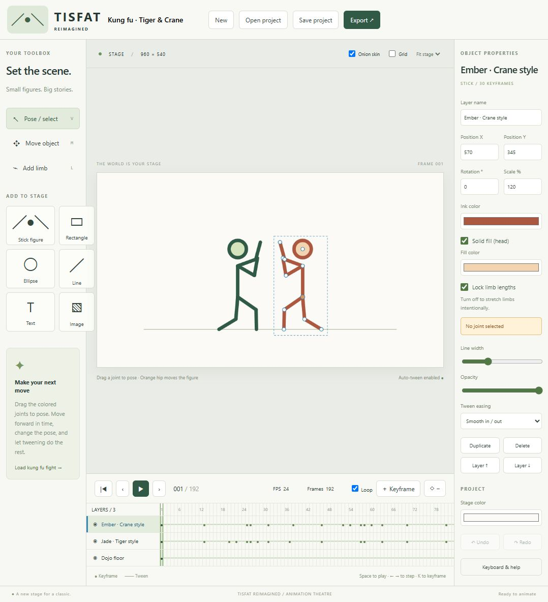

# TISFAT Reimagined

A locally hosted, browser-based reimagining of **TISFAT — This Is Stick Figure Animation Theatre**. Pose stick figures, set keyframes, and let tweening fill in the motion.



## Run locally

Requires **Node.js 18 or later**. No dependency installation or account is needed.

```sh
cd web
npm start
```

Open [http://127.0.0.1:4173](http://127.0.0.1:4173). On Windows you can also double-click `web/start.bat`. The server listens only on localhost; stop it with Ctrl+C.

## Features

- Pose articulated figures with locked limb lengths or intentional stretching.
- Add custom limbs with numbered joints, parent highlights, and attachment previews.
- Animate layers with keyframes, linear/smooth/hold tweening, and onion skins.
- Add rectangles, ellipses, lines, text, and images, with solid fills for shapes and figure heads.
- Adjust color, opacity, scale, rotation, layer order, and visibility.
- Undo/redo, browser autosave, and portable project save/open.
- Export PNG frames and WebM animations.
- Start with two kung fu fighters whose punches and kicks connect and trigger timed reactions.

Use **Space** to play, **Left/Right** to step, **K** to add a keyframe, and **V / M / L** for pose, move, and add-limb tools.

## Projects and compatibility

Projects use versioned `.tisfat.json` files. Download project backups before clearing browser data. Existing browser-edition projects remain compatible. Original Delphi `.fat` import, physics/Create-A-Scene, sound, video tracing, curved figures, bitmap limb attachments, and GIF/AVI/Flash export are not implemented. WebM export runs in real time; keep the tab active while exporting.

## Development

```sh
cd web
npm test
```

The app uses plain JavaScript and Canvas with a small Node.js static server. See [browser implementation notes](web/README.md) for more details.

## Original project

This repository contains the browser remake. It follows the original TISFAT layer, keyframe, tweening, and parented-joint concepts. The legacy Delphi source and build assets are available in the original repository linked below.

Original source: [backwards-engineer/TISFAT](https://github.com/backwards-engineer/TISFAT). The [original README](docs/legacy-readme.md) preserves the original author's background and licensing statement.
